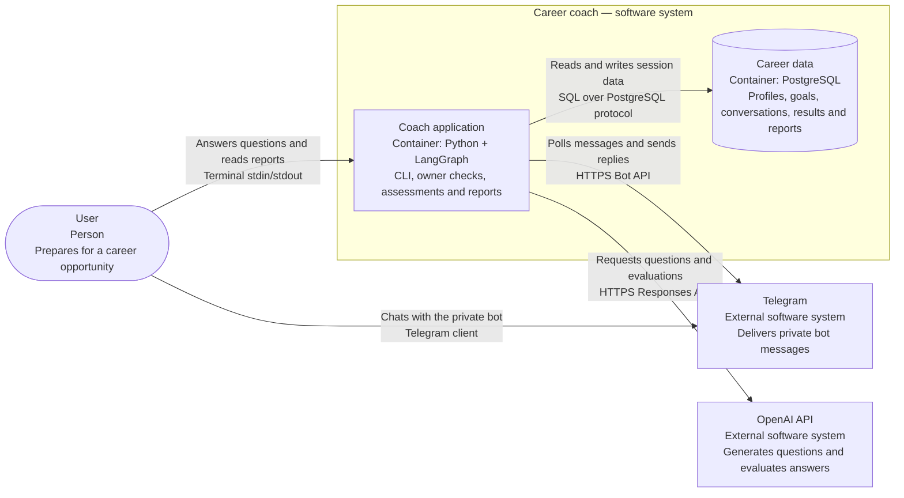

# nextLevelPersonalCoachForCareerLevel

## What it does

An AI career coach that helps students and professionals prepare for jobs, internships, research and entrepreneurial opportunities through a terminal or private Telegram chat. Each installation supports one user.

Provide a target opportunity or job description, background and preparation deadline. The coach asks two technical questions, a coding exercise and an interview scenario, with follow-ups when reasoning needs clarification. It produces a **Career Readiness Report** with demonstrated strengths, knowledge gaps, feedback, learning resources and a preparation plan.

Progress is saved between sessions. Submitted code is reviewed without execution. Opportunity discovery currently provides curated source suggestions and keyword matching against pasted descriptions; it does not retrieve live listings or verify eligibility.

## How to run

Requires Python 3.11+, [uv](https://docs.astral.sh/uv/), Docker Compose and an OpenAI API key. Docker must be running.

```sh
git clone https://github.com/lpanfilova/agent_career_coach.git
cd agent_career_coach
uv sync
cp .env.example .env
```

Configure `.env`:

- Set `OPENAI_API_KEY`.
- Choose `POSTGRES_PASSWORD` and update the password in `DATABASE_URL` to match. Keep the example host, port and database settings for the default Compose setup.
- For Telegram, set `TELEGRAM_BOT_TOKEN` from [BotFather](https://core.telegram.org/bots/tutorial#obtain-your-bot-token) and `TELEGRAM_USER_ID` to the account's numeric `message.from.id` from [getUpdates](https://core.telegram.org/bots/api#getupdates). Retrieve the ID after messaging the bot, before starting polling.

Keep `.env` private; it is excluded from Git.

```sh
docker compose up -d --wait
uv run career-coach chat
```

For Telegram, run `uv run career-coach telegram` instead, keep the process running and send `/start` privately to the bot. Only the configured user is accepted; group messages are ignored. Both interfaces share the same session.

Use `/resume` to continue, `/report` to retrieve the completed report, `/new` to start another assessment, `/metrics` for evaluation results, `/retake` to repeat a completed assessment, and `/help` for all commands. Terminal users can enter multiline text with `/paste`, finish with `/end`, and exit with `/quit`.

For a scripted walkthrough without OpenAI calls, run `uv run career-coach chat --demo`. PostgreSQL is still required. Stop the application with Ctrl+C and the database with `docker compose stop`.

## High-level architecture

**Container diagram — Career coach**



The boundary groups containers owned by the application. External services sit outside it; arrows show who initiates each interaction, with its purpose and interface. A container here means an application or data store, not necessarily a Docker container.

The Python application runs locally, and PostgreSQL runs in Docker Compose. LangGraph coordinates assessment turns; owner checks and report generation run within the Python application. Assessment content is sent to OpenAI, and Telegram transports messages when enabled.

## Evaluation

Use `/metrics` in CLI or Telegram to view sample counts and results:

- **Effectiveness:** completed assessments with saved reports / sessions with generated questions; demo and intake-only sessions are excluded.
- **Accuracy checks:** evidence quotes found in submitted answers and scores within expected ranges on three predefined examples.
- **User progress:** score changes on identical questions, criteria and model. Use `/retake` to repeat a completed assessment.

Answers use a 0–3 rubric. Missing data is shown as “not measured.” These prototype checks do not establish grading accuracy or overall career readiness; repeated practice can affect progress scores.

```sh
uv run python scripts/evaluate.py          # three billable OpenAI examples; saves metrics
uv sync --extra dev
uv run python scripts/check.py --postgres  # workflow, persistence and access-control tests
```
